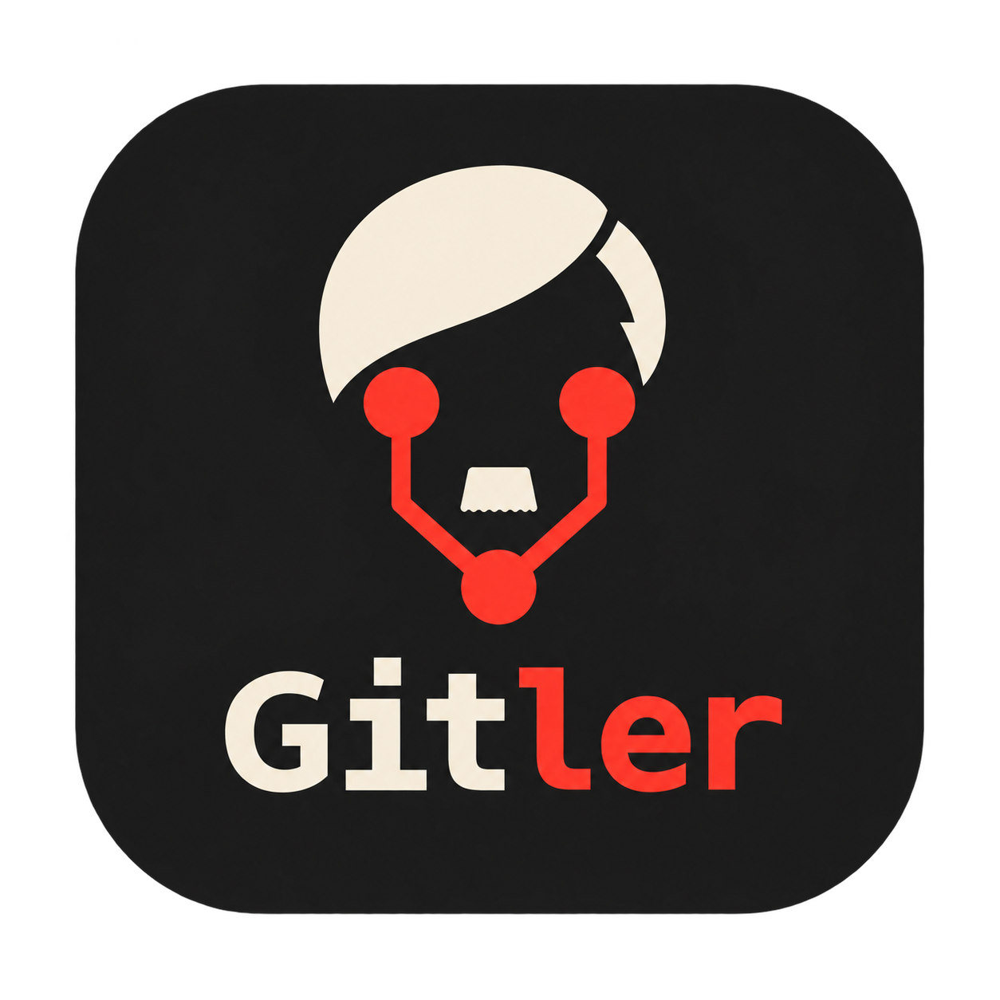

# Gitler

A desktop Git graph for developers working with many agents and worktrees. Open any
folder in a repository and see its entire history, branches, tags, stashes, and
uncommitted work across every registered worktree. Built with Tauri, React,
TypeScript, and shadcn/ui. Currently supported only on macOS with Apple Silicon.

## What it does

- Shows uncommitted changes as amber graph nodes attached to each worktree's HEAD.
- Opens the commit graph first, then checks working copies in the background.
- Surfaces detached, locked, and unavailable working copies in repository metadata.
- Inspects staged, unstaged, and untracked files without switching branches.
- Compares two commits or a commit and a worktree's current files: select one node,
  right-click another, and choose **Diff with selected**. The diff opens on the right.
- Renames local branches manually or suggests names with your installed Codex CLI for review.
- Discards selected staged, unstaged, and untracked files in a chosen working copy after confirmation.
- Fetches remote branches in the background and shows new commits without changing local work.
- Opens GitHub and other supported remote repositories in your default browser.
- Filters and searches loaded history; loads older commits on demand.
- Opens different repositories in separate windows, with at most one window per
  repository, including all of its worktrees.

The interface keeps the graph and a right-hand diff panel. Branches live in graph
labels; filters appear only when you open **Filters**. To inspect or compare a
commit outside the loaded history, enter its hash in search and press Enter. It
stays in the graph for selection and right-click comparisons.

Branch labels show **Merged into main** when their commits are part of the main
branch's history. Squash merges and GitHub's **Rebase and merge** are not automatically
recognized. Uncommitted work remains visible separately.

Drag the boundary between the graph and inspector, or between the file list and
diff preview, to resize the panels. The toolbar toggles the entire inspector;
the button beside **Changed files** toggles just the diff preview. Panel sizes and
visibility are remembered. Focus a boundary and use the arrow keys to resize it
with the keyboard.

Right-click a local branch label, its tip commit, or an uncommitted node and choose
**Rename branch…**. Enter a name manually, or use the **Generate with AI** sparkle
icon beside the field to suggest one from the branch's changes. AI generation requires a current
[Codex CLI](https://developers.openai.com/codex/cli) installation and `codex login`;
Gitler detects common installation paths and accepts an explicit executable path.
The selected branch's commits and working diffs are sent to Codex for generation.
The suggested name is editable before applying a local rename; remote names are unchanged.
Manual renaming works without Codex. The same context menu offers selected-file discards and merged-branch deletion with linked worktrees.

Discarding restores selected files to HEAD in both the index and working copy.
Selected untracked and newly added files are deleted permanently. Gitler verifies
that the reviewed files and HEAD have not changed; submodules and nested repositories
must be handled separately.

Deletion requires confirmation and a merge into the local default branch. Main branches
and the main worktree are protected; worktrees with changed, untracked, or ignored files
must be cleaned first. Locked or unavailable worktrees cannot be deleted.

Git mutations beyond remote updates, renaming, selected-file discards, and merged-branch
deletion remain outside the application's scope.

Remote branches update when you open a repository and every minute afterward. Use
**Refresh** to update them immediately. The status bar shows the last successful
update or a failure; click it to inspect remote addresses and retry. Gitler uses
your existing Git credentials. For private repositories, authenticate with Git
outside the app first. Offline use keeps the last fetched history available.
The toolbar opens `origin` (or another remote with a supported web address);
repository information offers an opening action for each remote. Local-path
remotes and SSH aliases without a web hostname have no browser link.

## Download

Install on macOS with Apple Silicon using Homebrew:

```sh
brew install --cask jeff-business/tap/gitler
gitler /path/to/repository
```

The [Homebrew tap](https://github.com/jeff-business/homebrew-tap) installs the app,
the `gitler` command, and Git. It tracks the newest published version, including
release candidates. Upgrade with `brew update && brew upgrade --cask gitler`.

The DMG and app archive are also available from
[GitHub Releases](https://github.com/lebedev-nikita/gitler/releases/latest).
Git must be installed and available on PATH. The app uses ad-hoc signing and is
not notarized.

## Run

On a Mac with Apple Silicon, install [Bun](https://bun.sh),
[Rust](https://rustup.rs), Git, and the
[Tauri macOS prerequisites](https://v2.tauri.app/start/prerequisites/#macos).

```sh
bun install --frozen-lockfile
bun run tauri dev
```

Choose **Open repository**, or pass a repository or worktree path from your terminal:

```sh
bun run tauri dev -- -- /path/to/any/worktree
```

Build the desktop application with `bun run tauri build`. The compiled executable
accepts `gitler /path/to/repository` or `gitler /path/to/worktree`. Each repository
opens in its own window, and the command returns immediately while the app keeps
running. Development launches stay attached to the terminal for logs and Ctrl+C.
Opening an already open repository or any of its worktrees brings that window to
the front and preserves your selection.

For a local release build, run `src-tauri/target/release/gitler .` from this
project, or put that executable on your PATH to use `gitler` from any folder.

To develop in the browser with a real local repository, run:

```sh
just dev /path/to/repository
```

`just dev .` opens the current project. It starts a local Git backend and opens
the browser without launching the desktop application. React updates live;
Rust changes rebuild the backend and reload the page. Stop with Ctrl+C.
Use **Open repository** to enter another local repository or worktree path.

`just desktop-dev /path/to/repository` runs the desktop version.
`just web` starts a browser preview with explicitly labeled demo data.

## Development

Common commands are in `justfile`: `just dev`, `just desktop-dev`, `just build`,
`just local-check`, and `just check`.
Git inspection lives in `src-tauri/src/git.rs`; the React interface is in `src/`.

Version tags such as `v0.1.0` trigger the desktop release workflow. It tests and
builds the macOS Apple Silicon app, attaches a DMG, app archive, and SHA-256
checksums to a draft release, and publishes after both downloads are verified.
After publication, it updates `Casks/gitler.rb` in the Homebrew tap and pushes the
new version and Apple Silicon archive checksum. The cask requires an ARM64 Mac.
The `HOMEBREW_TAP_TOKEN` Actions secret must contain a fine-grained token for
`jeff-business/homebrew-tap` with
`Contents: Read and write` permission.

Pushes to `main` and pull requests test and package the macOS Apple Silicon app without
publishing. To measure the full build with a warmed cache, run
`gh workflow run release.yml --ref main -f check_budget=true`; it fails if packaging
takes more than three minutes. Releases check this limit automatically, including
publication. Leave `publish` disabled for manual build checks.
